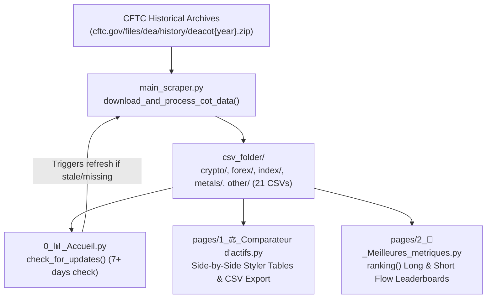

<h1 align="center">🏛️ CFTC Commitment of Traders (COT) Analytics</h1>

<p align="center">
  <strong>An automated multi-page Streamlit platform and CFTC Legacy Futures scraper for tracking weekly institutional non-commercial positioning, side-by-side asset orderflow divergence, and historical order-injection rankings across 21 Forex, Crypto, Equity Index, Metals, and Energy futures contracts.</strong>
</p>

<p align="center">
  <a href="#-executive-overview"><b>Overview</b></a> •
  <a href="#-application-pages--features"><b>Pages &amp; Features</b></a> •
  <a href="#-orderflow-ranking-methodology"><b>Methodology</b></a> •
  <a href="#-tracked-futures--cftc-codes"><b>21 Tracked Assets</b></a> •
  <a href="#-system-architecture"><b>Architecture</b></a> •
  <a href="#-repository-structure"><b>Structure</b></a> •
  <a href="#-installation--usage"><b>Setup</b></a> •
  <a href="#-license"><b>License</b></a>
</p>

<p align="center">
  
  
  
  
</p>

<p align="center">
  
  
  
</p>

---

## 📋 Executive Overview

**`Cot-Reports`** automates the ingestion and quantitative analysis of weekly **Commodity Futures Trading Commission (CFTC)** *Commitments of Traders* (`deacot`) legacy futures reports. By isolating **Non-Commercial (speculative / institutional)** long and short futures contracts, the platform enables macro and FX traders to monitor weekly institutional orderflow, spot diverging currency pair positioning, and rank the strongest contract inflows relative to each market's historical distribution.

When launched, the Streamlit home page (`0_📊_Accueil.py`) automatically checks the freshness of local CSV datasets (`csv_folder/forex/eur.csv`). If datasets are missing or older than **7 days**, it invokes `main_scraper.py` to fetch annual `deacot{year}.zip` archives directly from `cftc.gov`, parses all **21 configured contract codes**, and updates `csv_folder/` on disk.

> **UI Language Note**: While this documentation is written in English, the Streamlit page titles, sidebar links, and explanatory labels in `0_📊_Accueil.py`, `pages/1_⚖️_Comparateur d'actifs.py`, and `pages/2_💸_Meilleures_metriques.py` are presented in **French**.

---

## 🧩 Application Pages & Features

| Page File | UI Title (French) | Core Analytical Functionality |
|---|---|---|
| `0_📊_Accueil.py` | *Commitments of traders - Datas* | Auto-freshness check (`check_for_updates()` triggers `download_and_process_cot_data([2025, 2026])` if data is absent or $\ge 7$ days old), COT methodology primer, and Dashboard Options ecosystem links. |
| `pages/1_⚖️_Comparateur d'actifs.py` | *Comparateur d'actifs financiers* | Side-by-side weekly institutional positioning comparison for any two of the 21 contracts (default: `EUR` vs. `USD`) over a user-selected lookback slider. Renders a `seaborn` diverging gradient on `Net position`, zero-aligned positive/negative bars on `Change long` and `Change short`, and CSV export buttons. |
| `pages/2_💸_Meilleures_metriques.py` | *Plus grosses injections d'ordres des derniers rapports COT* | Ranks all 21 assets by the historical significance of their latest weekly orderflow injection, split into **Long Injection Rankings** (*Classement positions long*) and **Short Injection Rankings** (*Classement positions short*) formatted via `millify`. |
| `main_scraper.py` | *(CLI / Module Scraper)* | Downloads annual CFTC `deacot{year}.zip` bundles, extracts Non-Commercial Long/Short levels and weekly changes, computes `Net position`, deduplicates dates (`DD/MM/YY` newest-first), and writes standardized CSVs into `csv_folder/<category>/`. |

---

## 🧮 Orderflow Ranking Methodology

### 1. Standardized Weekly Net Positioning (`main_scraper.py`)

For each weekly report date $t$, the scraper extracts CFTC Non-Commercial open contracts and computes net positioning:

$$\text{Net Position}_t = \text{Long}_t - \text{Short}_t$$

Each exported CSV stores `Date`, `Long`, `Short`, `Change long`, `Change short`, `Net position`, `url_report`, and `type`.

### 2. Historical Orderflow Injection Ranking (`pages/2_💸_Meilleures_metriques.py`)

For every historical report row of an asset, `ranking()` decomposes weekly contract changes into directional buying flow ($\text{total\_long} \ge 0$, combining new long entries and short covering) and selling flow ($\text{total\_short} \le 0$, combining new short entries and long liquidations):

$$\Delta_{\text{flow}, t} = \text{total\_long}_t + \text{total\_short}_t = \Delta\text{Long}_t - \Delta\text{Short}_t$$

1. All historical positive flows ($\Delta_{\text{flow}, t} \ge 0$) are sorted descending; all negative flows ($\Delta_{\text{flow}, t} < 0$) are sorted ascending (most negative first).
2. The latest week's flow ($\Delta_{\text{flow}, 0}$) receives an intra-asset historical rank (`Rank 1` = largest positive or negative weekly orderflow injection in the dataset).
3. All 21 assets are then sorted across markets by their `Rank` to surface which futures contracts experienced unusually extreme institutional capital flows in the latest CFTC release.

---

## 🌐 Tracked Futures & CFTC Codes

`ALL_ASSET` in `main_scraper.py` tracks **21 contracts** across **5 asset categories** (`csv_folder/`):

| Category (`csv_folder/`) | Asset | CSV File | CFTC Market Code | Report Group |
|---|---|---|---|---|
| **Forex** (`forex/`) | Euro (`EUR`) | `eur.csv` | `099741` | `deacmesf` |
| **Forex** (`forex/`) | Japanese Yen (`JPY`) | `jpy.csv` | `097741` | `deacmesf` |
| **Forex** (`forex/`) | Australian Dollar (`AUD`) | `aud.csv` | `232741` | `deacmesf` |
| **Forex** (`forex/`) | New Zealand Dollar (`NZD`) | `nzd.csv` | `112741` | `deacmesf` |
| **Forex** (`forex/`) | Canadian Dollar (`CAD`) | `cad.csv` | `090741` | `deacmesf` |
| **Forex** (`forex/`) | British Pound (`GBP`) | `gbp.csv` | `096742` | `deacmesf` |
| **Forex** (`forex/`) | Swiss Franc (`CHF`) | `chf.csv` | `092741` | `deacmesf` |
| **Forex** (`forex/`) | Mexican Peso (`MXN`) | `mxn.csv` | `095741` | `deacmesf` |
| **Forex** (`forex/`) | Brazilian Real (`BRL`) | `brl.csv` | `102741` | `deacmesf` |
| **Forex** (`forex/`) | South African Rand (`ZAR`) | `zar.csv` | `122741` | `deacmesf` |
| **Forex** (`forex/`) | US Dollar Index (`USD`) | `usd.csv` | `098662` | `deanybtsf` |
| **Crypto** (`crypto/`) | Bitcoin (`BTC`) | `btc.csv` | `133741` | `deacmesf` |
| **Crypto** (`crypto/`) | Ethereum (`ETH`) | `eth.csv` | `146021` | `deacmesf` |
| **Index** (`index/`) | NASDAQ-100 (`NASDAQ-100`) | `nasdaq-100.csv` | `209742` | `deacmesf` |
| **Index** (`index/`) | S&P 500 (`S&P 500`) | `s&p 500.csv` | `13874A` | `deacmesf` |
| **Index** (`index/`) | Dow Jones (`DOW JONES`) | `dow jones.csv` | `124603` | `deacbtsf` |
| **Metals** (`metals/`) | Silver (`SILVER`) | `silver.csv` | `084691` | `deacmxsf` |
| **Metals** (`metals/`) | Copper (`COPPER`) | `copper.csv` | `085692` | `deacmxsf` |
| **Metals** (`metals/`) | Gold (`GOLD`) | `gold.csv` | `088691` | `deacmxsf` |
| **Other** (`other/`) | Crude Oil (`OIL`) | `oil.csv` | `067651` | `deanymesf` |
| **Other** (`other/`) | Natural Gas (`GAS`) | `gas.csv` | `023651` | `deanymesf` |

---

## 🏗️ System Architecture



---

## 📂 Repository Structure

```text
Cot-Reports/
├── .streamlit/
│   └── config.toml                        # Streamlit dark theme (#0E1117 background)
├── csv_folder/
│   ├── crypto/                            # btc.csv, eth.csv
│   ├── forex/                             # aud.csv, brl.csv, cad.csv, chf.csv, eur.csv, gbp.csv, jpy.csv, mxn.csv, nzd.csv, usd.csv, zar.csv
│   ├── index/                             # dow jones.csv, nasdaq-100.csv, s&p 500.csv
│   ├── metals/                            # copper.csv, gold.csv, silver.csv
│   └── other/                             # gas.csv, oil.csv
├── deacot2025_extracted/
│   └── annual.txt                         # Extracted CFTC 2025 annual report dataset
├── pages/
│   ├── 1_⚖️_Comparateur d'actifs.py       # Dual-asset COT comparison & diverging heatmap tables
│   └── 2_💸_Meilleures_metriques.py       # Historical order-injection ranking dashboard
├── .gitattributes
├── .gitignore
├── 0_📊_Accueil.py                        # Main Streamlit entrypoint & auto-update controller
├── LICENSE                                # MIT License
├── README.md                              # Project documentation
├── deacot2025.zip                         # Local 2025 CFTC annual archive
├── ideas.txt                              # French feature backlog & research notes
├── main_scraper.py                        # CFTC ZIP downloader & per-asset CSV generator
└── requirements.txt                       # Dependencies (streamlit, pandas, seaborn, requests, millify)
```

---

## 🚀 Installation & Usage

### Prerequisites

- **Python**: `3.9+`
- Internet access when refreshing weekly reports from `cftc.gov` (bundled `csv_folder/` allows immediate offline exploration)

### 1. Clone the Repository

```bash
git clone https://github.com/khalid-naami/Cot-Reports.git
cd Cot-Reports
```

### 2. Create a Virtual Environment & Install Dependencies

**Windows (PowerShell):**

```powershell
python -m venv .venv
.\.venv\Scripts\Activate.ps1
pip install -r requirements.txt
```

**macOS / Linux:**

```bash
python3 -m venv .venv
source .venv/bin/activate
pip install -r requirements.txt
```

### 3. Refresh CFTC Data Manually *(Optional)*

```bash
python main_scraper.py
```

### 4. Launch the Streamlit Application

```bash
streamlit run 0_📊_Accueil.py
```

Navigate between **Accueil**, **Comparateur d'actifs**, and **Meilleures metriques** in the Streamlit sidebar.

---

## 📡 Data Provider & Disclaimer

- **Regulatory Market Data**: U.S. Commodity Futures Trading Commission ([cftc.gov](https://www.cftc.gov/MarketReports/CommitmentsofTraders/index.htm)) Legacy Futures-Only annual archives (`deacot2025.zip` / `deacot2026.zip`).

> **Disclaimer**: Commitments of Traders data reflects lagged Tuesday institutional/non-commercial futures positioning released weekly by the CFTC. This dashboard is strictly for macroeconomic and quantitative market research and does not constitute trading or financial advice.

---

## 📜 License

Released under the **MIT License**. See [LICENSE](LICENSE) for full terms.
